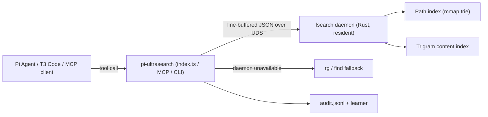

# pi-ultrasearch

> Whole-disk filesystem search, trigram content grep, and git-aware code discovery for **Pi Agent**, **T3 Code**, and MCP clients — backed by a persistent resident Rust daemon (`fsearch`).

[](CHANGELOG.md)
[](LICENSE)
[](https://github.com/Ghost-9/pi-ultrasearch/actions/workflows/ci.yml)
[]()

> **Honesty note.** Earlier versions of this README quoted best-case warm-cache micro-benchmarks as if they were
> session-level numbers, and claimed a green CI that never existed. Every figure below is now labelled with its
> measurement scope, and the full audit (`AUDIT-2026-10-14.md`) lists what was inflated and what changed.
> Live performance, limits and open gaps are documented rather than omitted.

---

## What it is

Agents lose time and context to `find`, `rg`, and `grep -rn` subprocesses. `pi-ultrasearch` keeps a resident index
of the filesystem (paths + trigram content) and answers those questions over a UNIX socket in **0.03–0.5 ms** while
staying inside the workspace boundary.

It ships as:

- a **Pi Agent extension** (6 tools + metrics tool + `/ultrasearch` commands),
- a **standalone CLI** (`ultrasearch query|grep|metrics|tui|compact`),
- a **stdio MCP server** for Antigravity, VS Code, Claude Desktop, and any MCP client,
- **QuickJS Code Mode** compatible tools (the Pi harness exposes registered tools to the sandbox).

---

## Measured performance (live, 2026-10-14, Apple Silicon)

### Warm socket micro-benchmarks (resident daemon, repeated calls)

| Operation | p50 | p95 | Notes |
|:---|:---:|:---:|:---|
| IPC ping | 0.031 ms | 0.112 ms | pure round-trip, 100 calls |
| Path search — small repo | 0.365 ms | 1.106 ms | 50 calls |
| Path search — Swift app repo | 0.475 ms | 1.141 ms | 20 calls |
| Trigram grep — small repo | 0.153 ms | 0.297 ms | 20 calls |
| Trigram grep — trigram-heavy scope | 0.480 ms | 0.784 ms | 50 calls |
| Multi-pattern grep | 1.842 ms | 5.886 ms | 10 calls, small scope |
| `git:modified` filter | 0.837 ms | 6.033 ms | 10 calls, clean tree |

Baseline comparison on the same scope (medians): **`find -name` 21.4 ms (45× slower)**, **`rg -l` 11.9 ms (78× slower)**,
`find` in a small repo 34.7 ms (95× slower).

### Real agent-session telemetry (production audit log, 38 organic calls)

| Tool | Calls | p50 | p95 | Max | Notes |
|:---|:---:|:---:|:---:|:---:|:---|
| `fsearch_query` | 13 | **41 ms** | **1,952 ms** | 4,007 ms | cold/global queries are the tail |
| `fsearch_grep` | 16 | 13.4 ms | 26.9 ms | 26.9 ms | |
| `fsearch_multi_grep` | 5 | 47.0 ms | 63.3 ms | 63.3 ms | |
| native fallback | 11/38 (29%) | — | — | — | daemon not used; being reduced |

**Read both tables together.** The warm path is genuinely sub-millisecond; a cold or whole-disk query can take
seconds. Tail latency and fallback rate are tracked as open work items (see `OPTIMIZATIONS.md`).

Planned performance work (tail latency, content coverage, concurrency, token accounting) is listed in
[`OPTIMIZATIONS.md`](OPTIMIZATIONS.md). The audit that produced these numbers is in [`AUDIT-2026-10-14.md`](AUDIT-2026-10-14.md).

---

## Tool surface

### 1. `fsearch_query`
Indexed file and path discovery, scoped to the active worktree (nearest `.git`), with an optional `global: true`.
- Strict zero typo tolerance: misspellings return 0 results (verified).
- Globs and filters: `src/**/*.{ts,tsx}`, `ext:rs`, `git:modified`, `git:staged`, `git:untracked`.
- Proximity re-ranking with `near:` or the `near` parameter.
- Respects declared `.gitignore` / `.ignore` rules in the scope root (outside git repos too).

### 2. `fsearch_grep`
Indexed trigram content search with four modes:
- `literal` (default), `regex`, `symbol` (AST declaration tags/priority), `semantic` (intent keyword expansion).
- Optional `context` lines (0–5) and `tag_symbols` for `[def:fn]`-style annotations.
- Enterprise DLP scrubbing before anything reaches the prompt.
- Content index covers the daemon's tracked text corpus — see *Known limits* below.

### 3. `fsearch_multi_grep`
Multi-pattern OR retrieval in one call with per-file match merging.

### 4. `fsearch_locate`
Exact filename resolution (`package.json`, `Cargo.toml`, …) with deduplication.

### 5. `fsearch_recent`
Frecency-ranked recent files, updated through the Pi `tool_execution_end` lifecycle hook.

### 6. `fsearch_metrics`
Latency percentiles, fallback rate, zero-hit diagnostics, CLI-bypass detector, and honest "tokens saved"
(is an estimate — see below).

---

## Observability

- **Audit log**: `~/.pi/agent/cache/pi-ultrasearch/audit.jsonl` — written by a **single layer** (the client),
  with test/benchmark runs isolated via `PI_ULTRASEARCH_TEST=1`. The regression gate no longer pollutes production data.
- **CLI-bypass detector**: flags `find`/`rg` subprocesses that could have used the index and feeds the recursive learner.
- **Recursive learner**: `recordMistake()` is now invoked by real failure paths (empty results, path mismatches,
  DLP interceptions, CLI bypasses), not just tests.
- **"Tokens saved" is an estimate**, computed as `150 + 75 × hits` for grep and `100 + 30 × hits` for path searches.
  It is not a prompt-token measurement; an A/B token-accounting harness is on the roadmap.

---

## MCP server

`bin/mcp-server.ts` speaks JSON-RPC 2.0 over stdio and exposes both `fsearch_*` and `ultrasearch_*` tool names.

Registration status:

| Client | Status |
|:---|:---|
| Antigravity | registered in `~/.gemini/antigravity/mcp_config.json` and `~/.gemini/config/mcp_config.json` |
| VS Code | registered in the user `mcp.json` |
| Claude Desktop | registered in `claude_desktop_config.json` |
| **Pi Agent** | **intentionally not registered via MCP** — the native extension already exposes the same tools; avoiding a duplicate tool surface |
| T3 Code | no generic user-level MCP registry; T3 reaches the tools through its Pi provider and the `ultrasearch` CLI |

Example MCP config entry:

```json
{
  "mcpServers": {
    "ultrasearch": {
      "command": "node",
      "args": ["/Users/batra/.pi/agent/extensions/pi-ultrasearch/bin/mcp-server.ts"]
    }
  }
}
```

---

## Testing & CI

```bash
npm test            # unit + integration (integration tests skip cleanly when the daemon is absent)
npm run test:gate   # hermetic mock-socket latency gate + live daemon gate (skips live if unavailable)
npm run typecheck   # tsc --noEmit
```

The CI workflow runs on a bare `macos-latest` runner with **no daemon installed**. It executes
`typecheck → npm test → test:gate`; the hermetic tests pass, daemon-dependent integration tests report as skipped,
and the hermetic mock-socket gate enforces p95 < 10 ms (search) and < 5 ms (grep) on the client IPC path.

The historical latency gate (real daemon, `test/benchmark-gate.test.ts`) still runs on developer machines and any
runner that provides the daemon.

---

## Known limits & gaps

- **Content-index coverage is partial** — the daemon indexes text for its tracked corpus (e.g. ~129 k docs of
  3.7 M entries on this machine). Path search is whole-disk; content grep is not.
- **Tail latency** — cold/global queries have been observed at 1.7–4.0 s. Per-query deadlines and partial results
  are not implemented yet.
- **Fallback quality** — when the daemon is unavailable the client falls back to `rg`/`find` (sync spawn). This is
  a correctness net, not the fast path.
- **Staleness windows** — `FSEvents dropped events` and segment compactions can briefly delay fresh results;
  `status` does not yet surface a staleness metric.
- **Platforms** — socket path resolution exists for Linux/Windows, but the daemon and CI are macOS-only today.
- **Frecency hook** — wired and covered by unit-level code paths, but no end-to-end regression test yet.
- Full list with priorities: [`OPTIMIZATIONS.md`](OPTIMIZATIONS.md).

---

## Architecture



Upstream engine: [`noahdunnagan/fsearch`](https://github.com/noahdunnagan/fsearch) (MIT, © Noah Dunnagan), pinned at
`v0.2.1` and tracked in `~/.cache/fsearch`. The daemon may be run from a macOS `.app` bundle (`UltraSearch.app`) so
Full Disk Access can be granted to a stable binary identity.

---

## License

pi-ultrasearch is licensed under the [GNU Affero General Public License v3.0](LICENSE) © 2026 Ghost-9.
The upstream `fsearch` engine is MIT-licensed; its notice is preserved when redistributing the engine binary.
